# FER2013 training and validation

## Dataset distribution

Of the 35,887 images, 68.0% went into training, 12.0% into validation, and 20.0% into the held-out test set used for evaluation.

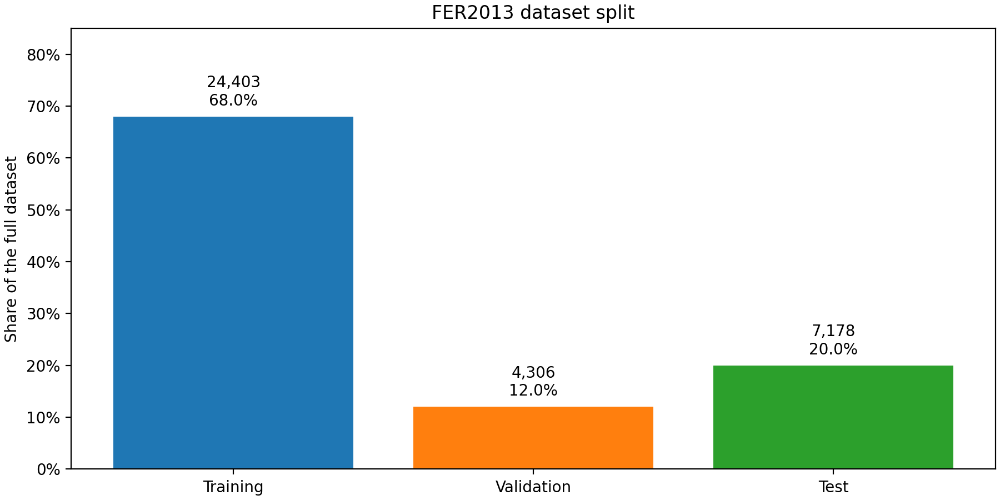

Across all three splits, happy is the most common expression (25.0%), and disgust is the least common (1.5%). Each bar shows the image count and its share of the full dataset.

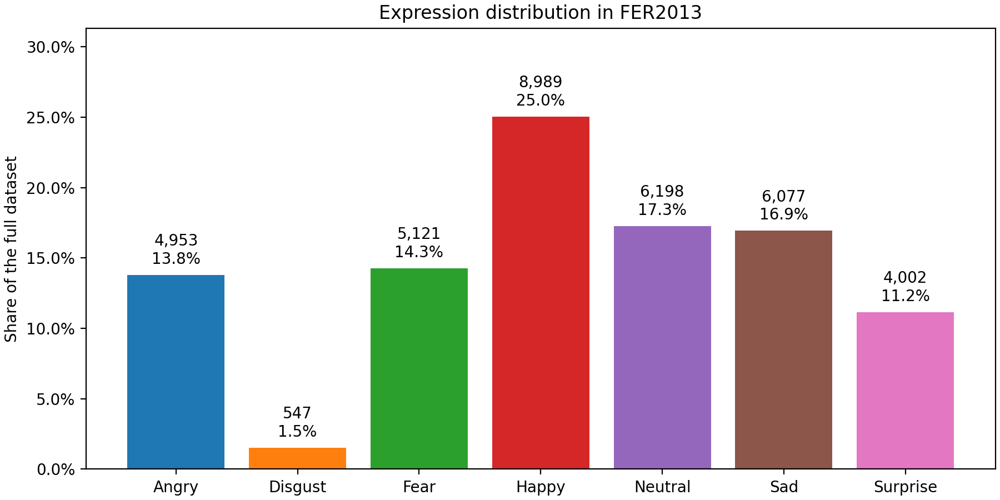

## Model architecture

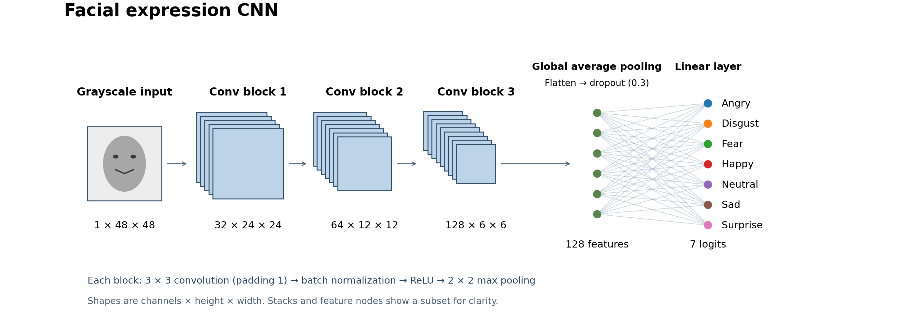

Shapes are shown per image as channels × height × width. Each convolutional block applies a 3 × 3 convolution with one pixel of padding, followed by batch normalization, ReLU, and 2 × 2 max pooling. The linear layer produces one raw score for each expression.

Six runs of the same CNN used budgets of 10, 25, 50, 100, 200, and 500 epochs. For every shorter run, the recorded training loss and validation macro F1 match the corresponding first epochs of the 500-epoch run.

## Training keeps improving after validation peaks

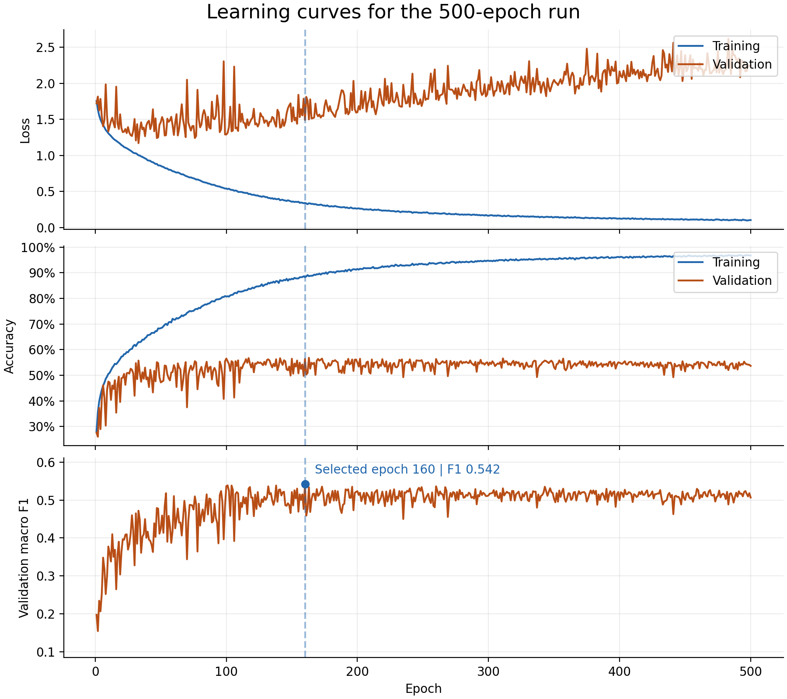

The 500-epoch run gives the full view. Validation macro F1 peaked at **0.5420 at epoch 160**, when validation accuracy was **56.39%**. By epoch 500, training accuracy reached **96.73%**, while validation accuracy fell to **53.67%** and macro F1 fell to **0.5066**. The widening train–validation gap is consistent with overfitting. Training accuracy here comes from batches as the model updates during each epoch, while validation uses the model at the end of the epoch.

## The final epoch can miss the best checkpoint

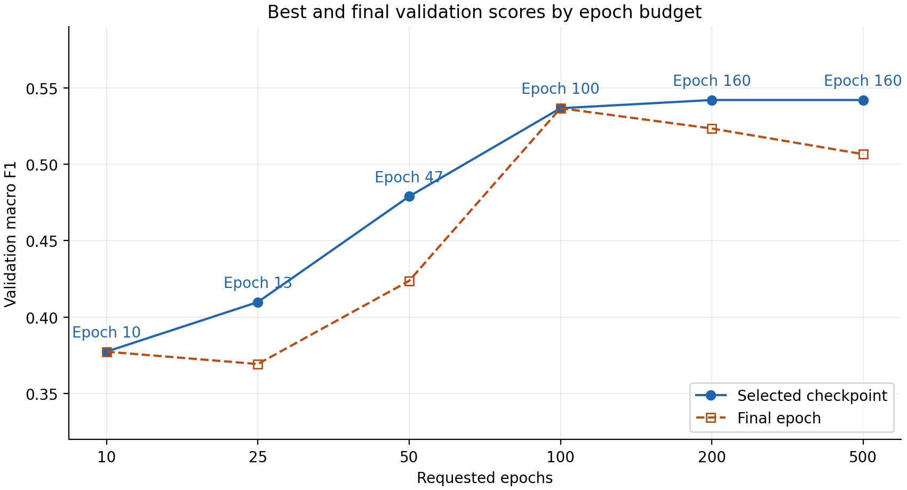

The script selects the checkpoint by validation macro F1, which averages the seven per-expression F1 scores equally. The 25-epoch budget selected epoch 13, and the 50-epoch budget selected epoch 47. Both the 200- and 500-epoch budgets selected epoch 160. The x-axis uses equally spaced categories to compare the six budgets.

| Epoch budget | Selected epoch | Best validation macro F1 | Final validation macro F1 | Recorded hours |
| ---: | ---: | ---: | ---: | ---: |
| 10 | 10 | 0.3774 | 0.3774 | 0.27 |
| 25 | 13 | 0.4098 | 0.3693 | 0.65 |
| 50 | 47 | 0.4790 | 0.4237 | 1.07 |
| 100 | 100 | 0.5366 | 0.5366 | 2.28 |
| 200 | 160 | 0.5420 | 0.5234 | 4.26 |
| 500 | 160 | 0.5420 | 0.5066 | 14.37 |

## Extra training time brought smaller gains

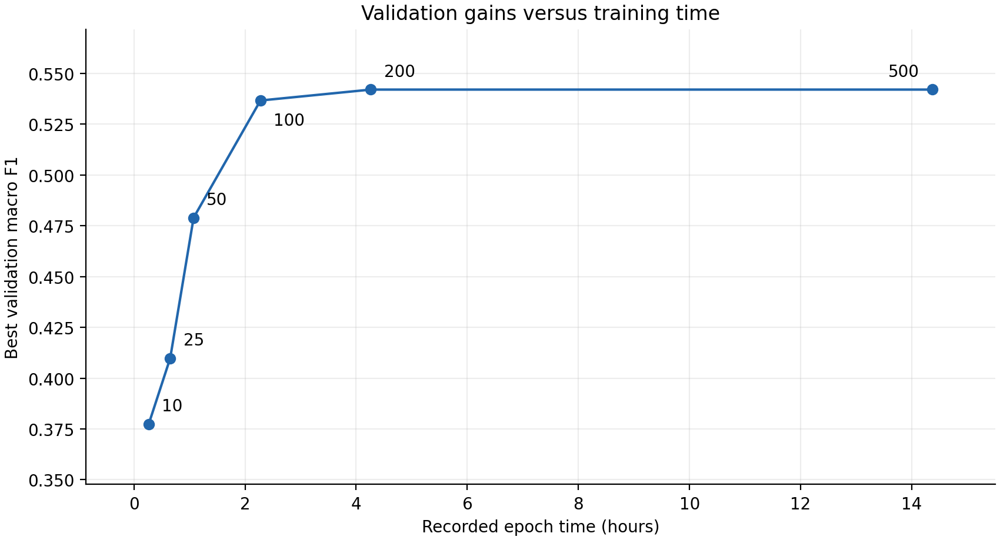

The 100-epoch run reached **0.5366** in **2.28 hours**. The 200-epoch run improved that by about **0.0054 macro F1**, and the 500-epoch run added approximately **10.1 hours** beyond the 200-epoch run with the same best score. Runtime is the sum of the logged epoch durations. It includes validation and checkpoint writing during each epoch and depends on the machine and run conditions.

## Validation recall at saved checkpoints

I rescored the six archived checkpoints on the same 4,306 validation images. Validation accuracy and macro F1 matched the original logs for all six checkpoints. The 200- and 500-epoch runs both saved epoch 160 and produced identical confusion matrices, so they share one point. The lines connect the five measured epochs (10, 13, 47, 100, and 160). Only the dots represent measured recall.

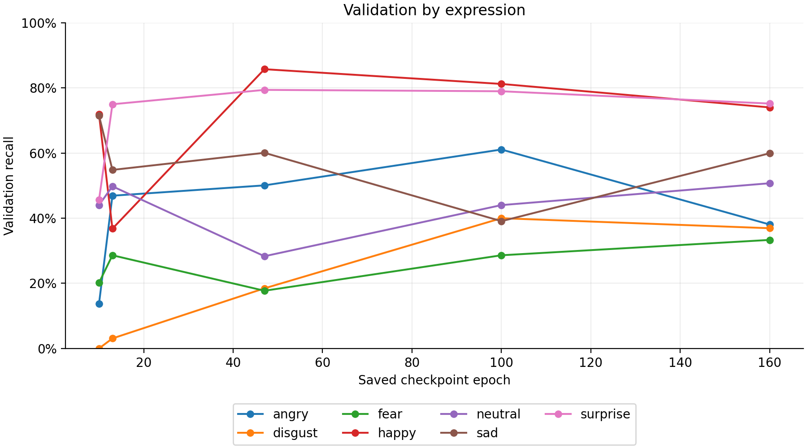

At epoch 160, recall was highest for surprise (75.21%) and happy (74.03%). The model recognized 24 of 65 disgust examples (36.92%) and 205 of 615 fear examples (33.33%). The [recovered metrics CSV](checkpoint_class_metrics.csv) includes precision, recall, F1, and support for each expression and checkpoint.

### Individual expression plots

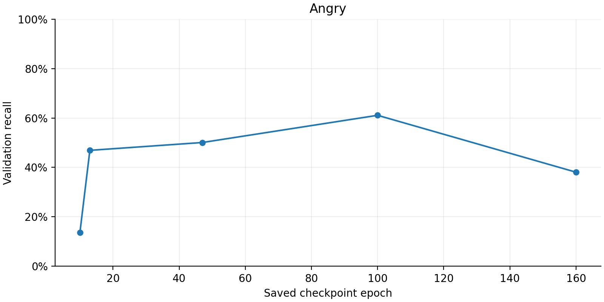

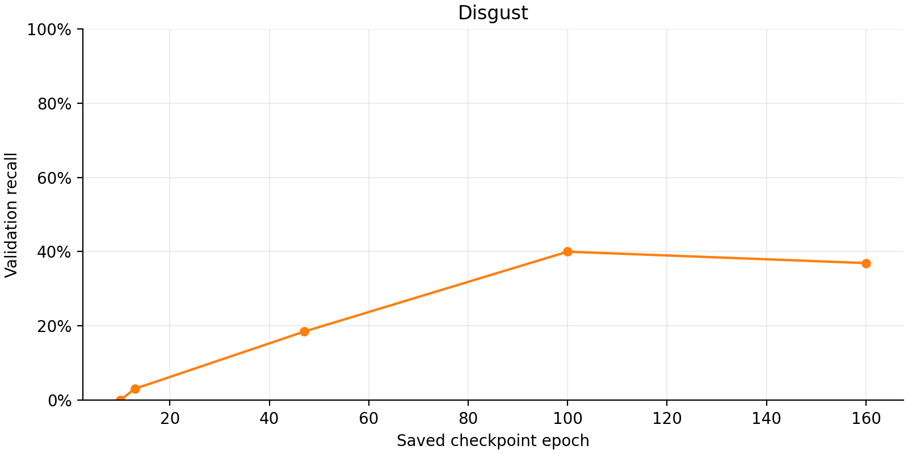

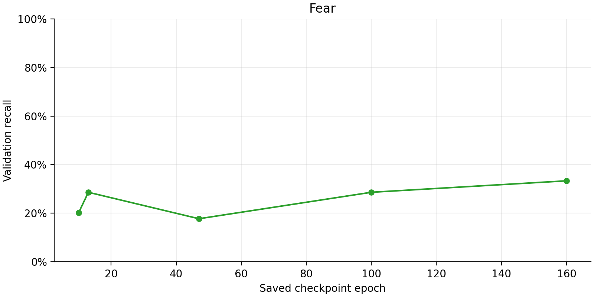

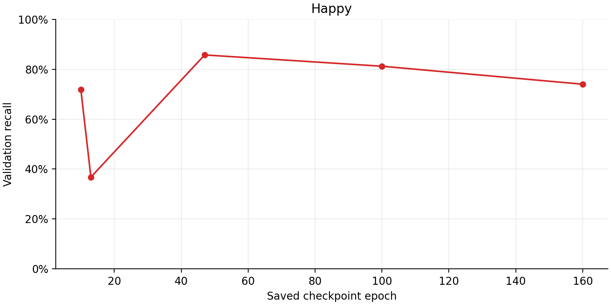

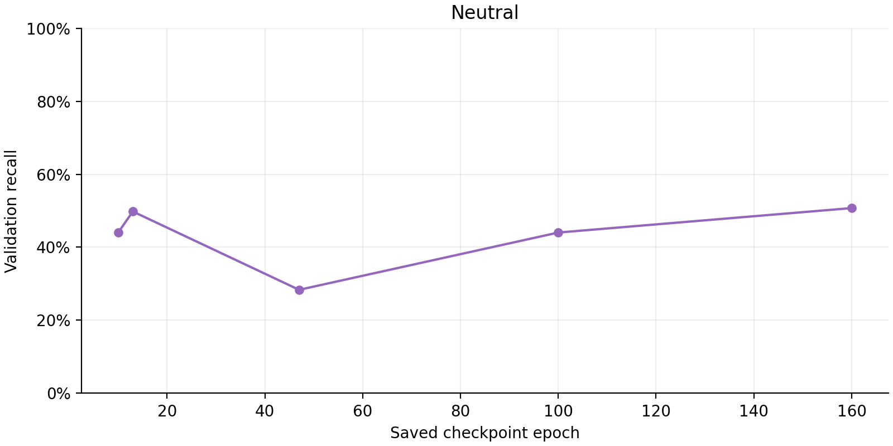

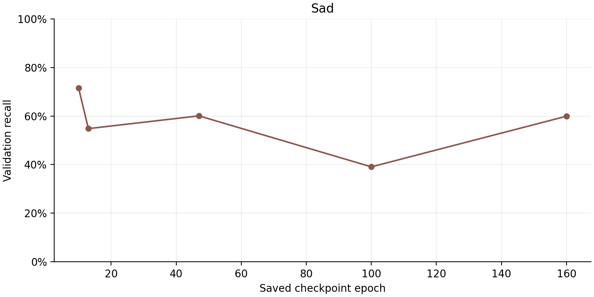

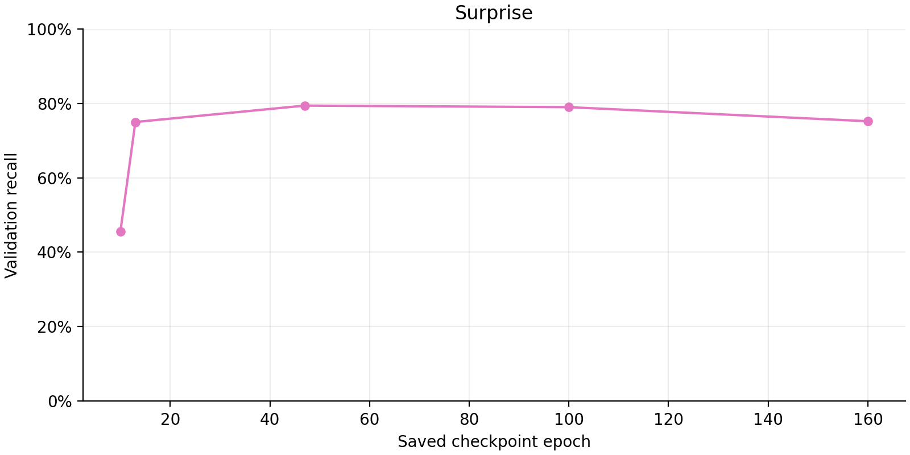
